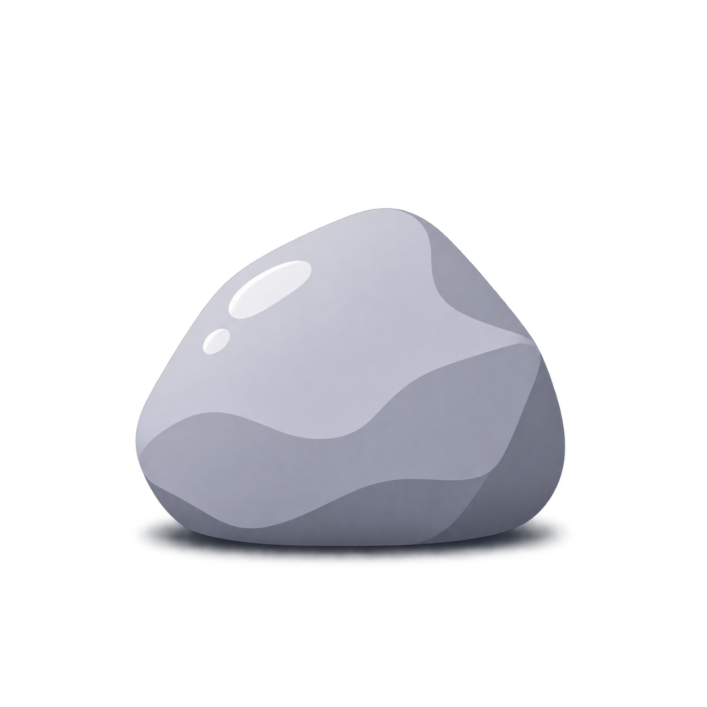

<div align="center">



# rocks

**Screenshot annotation for Linux, built for agents.**<br>
Mark regions, number them, comment, and paste the image *and* your notes anywhere.

[](LICENSE)
[](#-desktop-support)
[](https://gtk-rs.org)
[](#-desktop-support)
[](#-install)
[](https://github.com/micuele/rocks/actions/workflows/ci.yml)

</div>

<!-- Demo: save the recording as assets/demo.gif, then uncomment the line below.
<p align="center"></p>
-->

## ✨ Features

- **Numbered regions** — drag a rectangle or arrow, type a comment; numbers stay in sync through edits and undo.
- **One copy, every format** — the clipboard holds the PNG, a numbered text list and HTML at once.
- **AI-chat ready** — pasting into a chat attaches the image *and* a Markdown file with your comments, so they're read as text.
- **Fast by design** — opens fullscreen on Print Screen, Enter copies and closes, Esc cancels.
- **Crop without switching tools** — right-drag to crop; multi-monitor captures auto-crop to your screen on KDE.

## 📦 Install

Grab a package from the [latest release](https://github.com/micuele/rocks/releases/latest):

| Distribution | Command |
|---|---|
| **Ubuntu 22.04+ · Debian 12+ · Mint 21+** | `sudo apt install ./rocks_*_amd64.deb` |
| **Fedora 43+** | `sudo dnf install ./rocks-*.x86_64.rpm` |
| **Arch · Manjaro · EndeavourOS** | `sudo pacman -U ./rocks-*.pkg.tar.zst` |

Or build the Arch package yourself: `git clone https://github.com/micuele/rocks && cd rocks/packaging/arch && makepkg -si`

Then install the capture tool for your desktop (see [Desktop support](#-desktop-support)). On KDE, make Print Screen open rocks:

```sh
rocks-setup-kde            # rocks-setup-kde --restore gives it back to Spectacle
```

<details>
<summary><b>Build from source</b></summary>

<br>

Needs Rust 1.85+ ([rustup](https://rustup.rs)) and GTK 4.6+ / libadwaita 1.1+ development files:

| Distribution | Packages |
|---|---|
| Fedora | `gtk4-devel libadwaita-devel libepoxy-devel fontconfig-devel gcc pkgconf-pkg-config` |
| Debian / Ubuntu | `libgtk-4-dev libadwaita-1-dev libepoxy-dev libfontconfig1-dev build-essential pkg-config` |
| Arch | `base-devel gtk4 libadwaita libepoxy` |

```sh
cargo build --release --locked
python3 install.py target/release/rocks                 # installs into ~/.local
/usr/bin/python3 install-kde.py target/release/rocks    # …or the same plus the KDE Print Screen binding
```

</details>

## 🚀 Usage

Press **Print Screen** (or run `rocks-capture`). The capture opens fullscreen with the rectangle tool ready.

| Action | Keys |
|---|---|
| Mark a region · add a comment | drag, type, <kbd>Enter</kbd> (<kbd>Shift</kbd>+<kbd>Enter</kbd> for a new line) |
| Edit a comment | click its numbered badge |
| Crop | right-drag (right-drag again to move or resize) |
| Pan | hold <kbd>Space</kbd> and drag |
| Tools | <kbd>R</kbd> rectangle · <kbd>Z</kbd> arrow · <kbd>B</kbd> brush · <kbd>I</kbd> line |
| Undo · redo · clear | <kbd>Ctrl</kbd>+<kbd>Z</kbd> · <kbd>Ctrl</kbd>+<kbd>Y</kbd> · <kbd>Delete</kbd> |
| Save · save as | <kbd>Ctrl</kbd>+<kbd>S</kbd> · <kbd>Ctrl</kbd>+<kbd>Shift</kbd>+<kbd>S</kbd> |
| **Copy and close** · cancel | <kbd>Enter</kbd> · <kbd>Esc</kbd> |

Already have a screenshot? `rocks --filename shot.png`

## 💻 Desktop support

| Desktop | Capture tool | Status |
|---|---|---|
| KDE Plasma (Wayland & X11) | `spectacle` | ✅ Tested · Print Screen setup · per-monitor crop |
| Sway, Hyprland & other wlroots | `grim` | 🧪 Experimental |
| X11 (GNOME, Xfce, …) | `gnome-screenshot` or ImageMagick | 🧪 Experimental |
| GNOME on Wayland | — | ❌ Capture not integrated; open a screenshot with `rocks --filename` |

On Wayland, copying to the clipboard needs XWayland.

## 📚 Documentation

- [Usage details](docs/usage.md) — capture backends, clipboard formats, configuration
- [Development](docs/development.md) — tests, CI, packaging and releases

## 📄 License

[MPL-2.0](LICENSE). Third-party notices and source availability: [NOTICE.md](NOTICE.md).
